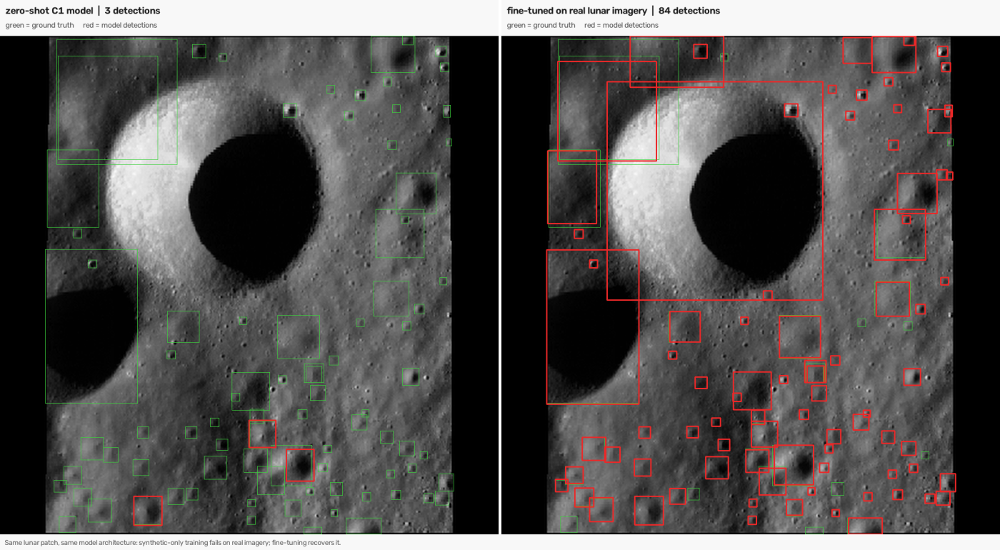
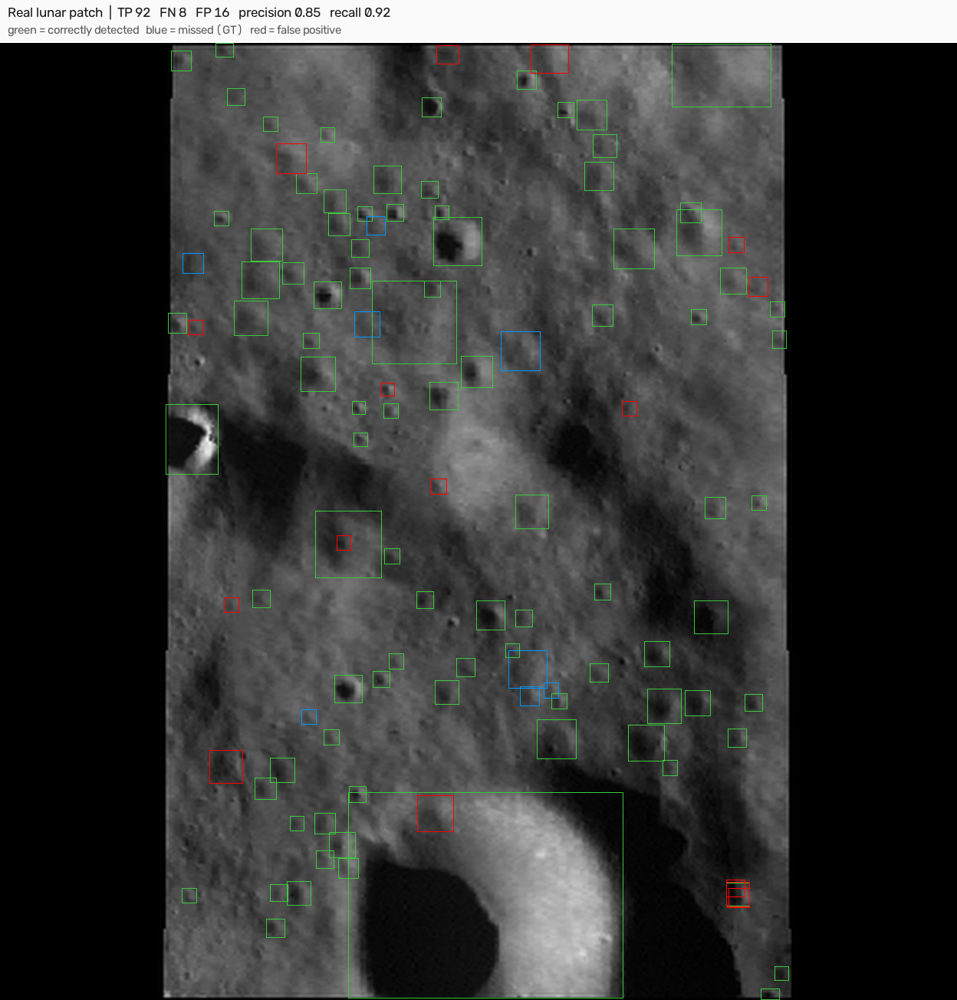

# lunar-trn

Crater-based terrain-relative navigation (TRN): detect lunar craters, fit precise
ellipses, estimate camera pose, and evaluate localization-relevant perception for
GNSS-denied environments.



*Left: a synthetic-trained detector on real lunar imagery (3 detections). Right: the same
architecture fine-tuned on real imagery (84 detections). Green = ground truth, red = model
detections.*

## Results

| Task | Metric | Result |
|---|---|---|
| NASA Crater Detection benchmark (held-out split, 200 images) | CDA (official scorer) | **91.97** (95% CI 89.93–93.80) |
| Real lunar imagery (LU3M6TGT), fine-tuned, held-out patches | mAP50 | **0.947** |
| Human-verified craters ≥2 km (Robbins catalogue) | recall | **0.606** |
| Pose, oracle correspondences (CRESENT, DEM) | position / attitude | **1.7–3 km / 0.6–1.7°** |
| Blind position, attitude known (CRESENT) | success <5 km @ 0/20/40/60° | **96 / 95 / 80 / 64%** |

*CDA on the 200-image held-out split (official scorer); CI from 10k bootstrap resamples.
Pose uses oracle correspondences (ground-truth projections) — an upper bound. Blind
position assumes known attitude/altitude (star-tracker mode).*



*Real lunar patch: correctly detected craters (green, TP 92), missed ground truth (blue,
FN 8), false positives (red, FP 16); precision 0.85, recall 0.92.*

## How it works

```
image → YOLO detector → instance masks → cv2.fitEllipse → CDA scoring
                       ↘ matched to catalogue craters → solvePnP → pose
```

The benchmark score (CDA) rewards ellipse fidelity including rotation. That is why
segmentation + `fitEllipse` outperforms box detectors despite a lower box-mAP. The pose
pipeline matches detected craters to the Robbins catalogue and solves for camera position
and attitude; the blind variant requires no prior position.

```
src/
├── prepare.py        build box/seg datasets from NASA C1 ellipse labels
├── train.py          config-driven trainer (configs/)
├── predict.py        C1 inference → challenge-format ellipse CSV
├── infer.py          inference on real (LU3M6TGT) and CRESENT imagery
├── metrics/          CDA + top-k sweep, bootstrap CI, AP/Robbins audit, leak audit
├── crescent/         viewpoint homography analysis
└── pose/             LOLA DEM sampler, Tier-A pose evaluation, blind position matching
```

## Quickstart

```bash
pip install -r requirements.txt     # install torch for your accelerator first
python src/prepare.py --task seg --gt data/nasa-craters/train-gt.csv \
    --images-root data/nasa-craters/train-extracted/train --out data/c1-full-seg
python src/train.py --config configs/c1-seg.yaml
python src/predict.py --model runs/segment/runs/full-v1s-seg/weights/best.pt \
    --images data/c1-full-seg/images/val --out preds/seg.csv --conf 0.05
```

Datasets are not bundled; the paths above assume the standard layout.

## Model weights

| Model | Purpose | Link |
|---|---|---|
| `lunar-trn-seg` | C1 segmentation (CDA 91.97) | https://huggingface.co/huseyincavus/lunar-trn-seg |
| `lunar-trn-ft-real` | real-domain detector (mAP50 0.947) | https://huggingface.co/huseyincavus/lunar-trn-ft-real |

## Data & licences

NASA Crater Detection Challenge (public, research use) · LU3M6TGT (CC BY-SA 4.0) ·
Robbins 2018 catalogue (PDS) · CRESENT (academic use) · LOLA LDEM_64 (PDS).
No data is bundled; weights are hosted on Hugging Face.

## Limitations

- Benchmark numbers use a held-out split of the challenge data; the official test ground
  truth is not public.
- The synthetic-trained model transfers poorly to real imagery zero-shot (mAP50 ≈ 0.03 at
  the matched inference scale; 0.09 at the best inference scale); real-domain results
  require the fine-tuned model.
- Real-domain labels are catalogue-derived and incomplete (≈59% coverage of Robbins ≥2 km
  craters), so precision against them understates true detection.
- Fine-tuning specializes the model (it forgets the synthetic domain).
- Blind pose assumes known attitude/altitude (star-tracker mode); full 6-DOF blind pose is
  future work.
